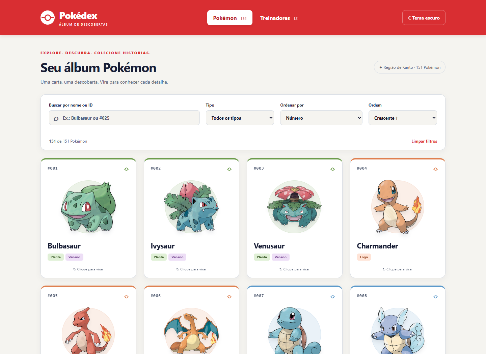

# Pokédex — Álbum de descobertas

Atividade 03 de Desenvolvimento e Integração de Aplicações Web. Aplicação acadêmica em React + Vite, com JavaScript/JSX, 151 Pokémon e 12 treinadores do JSON fornecido. Sem backend ou banco de dados.



## Executar

Recomendado: Node.js 24 e npm. Na pasta do projeto:

```bash
npm install
npm run dev
```

Abra **http://127.0.0.1:5173**. Se essa porta estiver ocupada, use o endereço informado pelo Vite no terminal. Para encerrar, pressione Ctrl+C.

```bash
npm run build
npm run preview
```

O build fica em `dist/`. O preview normalmente usa **http://127.0.0.1:4173**. Os comandos precisam permitir os subprocessos do Vite/esbuild no ambiente de execução.

## Usar o álbum

- Busque pelo nome parcial ou por ID exato: `25`, `025` e `#025` encontram Pikachu. Espaços externos e maiúsculas são ignorados.
- Combine busca com tipo, inclusive tipos secundários, e ordene por número, nome ou qualquer um dos seis atributos, nos dois sentidos. Empates usam ID crescente. “Limpar filtros” preserva a ordenação.
- Clique, Enter ou Espaço vira/desvira cada carta independentemente. Hover apenas destaca. Os versos mostram os seis valores originais e barras na mesma escala global, mesmo com filtros ativos.
- A última carta Pokémon virada abre o painel de treinadores. Virar outra troca o contexto sem desvirar a anterior. Desvirar a carta vinculada fecha o painel; desvirar outra não interfere.
- X/Escape fecha apenas o painel. Escape e o fechamento por teclado devolvem foco à carta vinculada. O painel não é modal, não captura foco e não tem temporizador.
- Filtrar a carta vinculada para fora da lista ou trocar de aba fecha o painel. As viradas são preservadas; nenhum perfil anterior reabre automaticamente. Para reabrir o perfil de uma carta já virada, desvire e vire novamente.
- A aba Treinadores permite virar várias cartas, sem abrir painel. Equipes mantêm ordem e repetições, incluindo as de Koga e Lance. Insígnias são quantidades do JSON, não coleções inventadas.
- Mew tem tipos vazios nos dados originais e mostra “Tipo não informado”. A opção “Sem tipo” representa o tipo explícito `Typeless`, que é diferente de uma lista vazia.
- O primeiro acesso usa tema claro. A escolha persiste em `localStorage`; se o armazenamento estiver bloqueado, a alternância funciona na sessão.
- O layout se adapta ao celular, tablet e desktop; respeita redução de movimento, oferece foco visível e mantém a face oculta fora da acessibilidade. O painel fica limitado a 40vh no celular e há espaço de rolagem para acessar as cartas atrás dele.

## Dados e imagens

`src/data/pokedex-data.json` é uma cópia textual integral do `pokedex-data.json` original da raiz. A aplicação importa somente a cópia em `src/data`. Não corrige nomes, atributos, tipos, equipes ou insígnias com valores de APIs ou imagens de referência.

Fonte dos dados: [material da disciplina](https://github.com/joaopauloaramuni/desenvolvimento-e-integracao-de-aplicacoes-web/blob/main/ATIVIDADES/ATIVIDADE%2003%20-%20JSON/data/pokedex-data.json). O enunciado e os materiais recebidos estão preservados na raiz.

Ilustrações: [repositório de sprites da PokéAPI](https://github.com/PokeAPI/sprites), usando `https://raw.githubusercontent.com/PokeAPI/sprites/master/sprites/pokemon/other/official-artwork/{id}.png`. As 151 URLs foram verificadas com HTTP HEAD em 26/10/2026 e retornaram HTTP 200 com conteúdo de imagem. A disponibilidade futura depende do serviço externo.

Não há consulta aos metadados da API: as URLs são derivadas do ID e o cache de imagens é o cache HTTP do navegador, conforme os cabeçalhos do servidor. Imagens têm carregamento tardio e fallback local com prevenção de loops; a consulta dos dados funciona mesmo sem conexão após carregar o aplicativo.

**Todos os 12 retratos de treinadores são provisórios.** O avatar genérico e o fallback Pokémon são SVGs locais criados para este projeto. Para substituir retratos, adicione arquivos com o ID do treinador em `src/assets/images/trainers/`, por exemplo `1.png` para Ash. Formatos aceitos: png, jpg, jpeg, webp e svg. O mapeamento em `src/data/trainerImages.js` incorpora esses arquivos no build. Registre aqui a fonte e a licença dos retratos adicionados.

ID de Pokémon inexistente em uma equipe recebe nome identificável e fallback, preservando sua posição. Repetições têm chaves compostas por treinador, posição e ID; não duplicam o perfil inteiro no painel.

## Estrutura e dependências

```text
src/
  assets/images/trainers/  Retratos locais opcionais por ID
  components/              Cabeçalho, controles, cartas, equipes e painel
  css/                     Tokens e estilos de layout, cartas e treinadores
  data/                    JSON original e mapeamento de retratos
  hooks/                   Tema com persistência
  utils/                   Seletores, relações, escala e transições de cartas
  App.jsx                  Estados e integração dos componentes
  main.jsx                 Entrada React
public/images/             Fallbacks SVG locais
tests/                     Testes de dados e comportamento dos seletores
e2e/                       Testes no navegador
```

React e React DOM são as dependências de execução. Vite e o plugin React fazem o desenvolvimento/build; ESLint, o plugin de hooks e globals verificam o código; Prettier formata os arquivos; Playwright testa o navegador. Todas as versões estão no `package.json` e fixadas pelo `package-lock.json`. Estilos e animações usam CSS, sem biblioteca visual adicional.

## Verificações

```bash
npm run lint
npm test
npm run test:e2e
npm run build
npm run format
```

Os testes de navegador usam **Microsoft Edge instalado** e iniciam/encerram seu próprio Vite na porta 5173, que precisa estar livre. Se necessário, instale o navegador com `npx playwright install msedge`. Para outro navegador, ajuste `channel` em `playwright.config.js` e instale o navegador correspondente.

Os seis testes de unidade cobrem preservação do JSON, busca, combinação com tipo secundário, ordenação de todos os campos nos dois sentidos, empates, duplicatas, IDs inexistentes, tipos vazios, escala global e transições das cartas. Os dez testes de navegador cobrem controles, teclado, painel, equipes, tema persistido e armazenamento bloqueado, fallback de imagem, ausência de associação, movimento reduzido e layout em 320/375/768/1440 px nos dois temas. As imagens externas são simuladas nessa suíte para garantir testes reproduzíveis, incluindo respostas 404. A verificação das 151 URLs foi feita separadamente.

Capturas geradas e rastros de falhas ficam em `test-results/`, ignorado pelo Git. As verificações não substituem avaliação manual com leitores de tela reais.

## Autoria da dupla

Preencher somente com os dados e a participação real de cada integrante:

| Integrante | Nome | Participação real em pair programming |
| --- | --- | --- |
| 1 | A preencher | A preencher |
| 2 | A preencher | A preencher |

O desenvolvimento mantém commits locais incrementais no formato Conventional Commits. Publicação, criação de remoto e push devem ser realizados pela dupla quando solicitado; nenhum desses passos faz parte da execução automática deste projeto.
