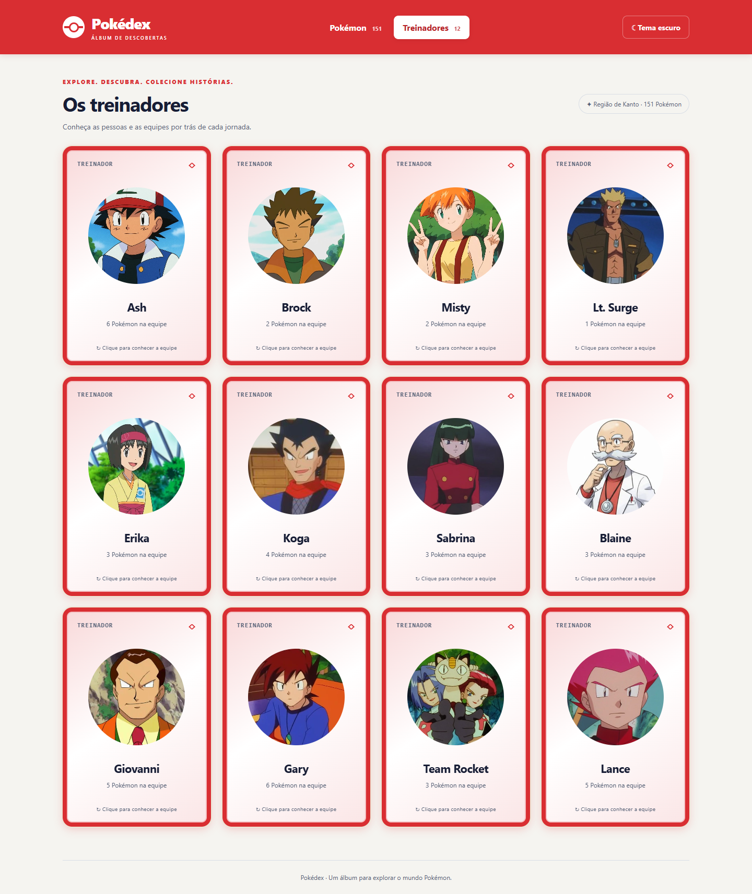

# Pokédex — Álbum de descobertas

Projeto desenvolvido individualmente para a Atividade 03 de Desenvolvimento e Integração de Aplicações Web. Aplicação em React + Vite, com JavaScript/JSX, para explorar os **151 Pokémon e 12 treinadores** do JSON fornecido pela disciplina. Sem backend ou banco de dados.


## Executar

Ambiente utilizado no desenvolvimento: **Node.js 24 e npm**.

```bash
npm install
npm run dev
```

Abra **http://127.0.0.1:5173**. Se a porta estiver ocupada, use o endereço informado pelo Vite no terminal. Para encerrar, pressione Ctrl+C.

Para gerar e conferir a versão de produção:

```bash
npm run build
npm run preview
```

O build fica em `dist/`. O preview normalmente usa **http://127.0.0.1:4173**. O ambiente precisa permitir os subprocessos do Vite/esbuild.

## Explorar os Pokémon

- Pesquisa imediata por nome parcial, ignorando maiúsculas e espaços externos, ou ID exato: `25`, `025` e `#025` encontram Pikachu.
- Filtro por um tipo, incluindo tipos secundários, combinado com a pesquisa e a ordenação.
- Ordenação por ID, nome, HP, Ataque, Defesa, Ataque Especial, Defesa Especial e Velocidade, em ordem crescente ou decrescente. Empates usam ID crescente, sem alterar o JSON.
- Contagem de resultados, mensagem para buscas sem correspondência e ação **Limpar filtros**, que mantém a ordenação selecionada.
- Cartas com ID, ilustração, nome e todos os tipos na frente. O verso mostra os seis atributos originais, com valores e barras na mesma escala global, calculada a partir de todos os Pokémon.
- Clique, Enter ou Espaço vira/desvira cada carta. Várias cartas podem permanecer viradas; pesquisa, filtros, ordenação e troca de aba preservam as viradas. Hover apenas destaca a carta.

Mew tem uma lista de tipos vazia no arquivo original e mostra **Tipo não informado**. Isso é diferente da opção **Sem tipo**, que corresponde ao tipo explícito `Typeless`.

## Visual e acessibilidade

O álbum usa conteúdo centralizado, molduras espessas com contorno claro e brilho, além da faixa **Ver atributos** na frente e **Ocultar atributos** no verso. As cores das bordas são extraídas do fundo dos símbolos fornecidos: Fogo é vermelho, Água é azul, Planta é verde e Normal é cinza. Fundos, brilho, barras e faixas usam a mesma cor ou variações dela.

Em Pokémon com dois tipos, o **primeiro tipo do JSON** define a moldura e o símbolo do canto; os dois continuam visíveis nas etiquetas. As cores representam os elementos, independentemente da aparência do Pokémon. Cartas de treinadores usam a moldura vermelha e retratos circulares, com a imagem preenchendo o círculo.

O primeiro acesso começa no tema claro. A alternância para o escuro é salva em `localStorage`; se o armazenamento estiver bloqueado, continua funcionando na sessão.

O layout se adapta ao celular, tablet e desktop, com labels, foco visível, navegação por teclado, descrições dos detalhes e respeito à preferência por redução de movimento. A face oculta fica fora da acessibilidade. A interface foi conferida em **320, 375, 768 e 1440 px**.

## Treinadores e painel contextual

A aba Treinadores apresenta Ash, Brock, Misty, Lt. Surge, Erika, Koga, Sabrina, Blaine, Giovanni, Gary, Team Rocket e Lance. As cartas mostram o retrato e o nome na frente; no verso, a quantidade de insígnias e a equipe. Vários treinadores podem ficar virados sem abrir o painel contextual.



As equipes mantêm a ordem e as repetições de `pokemonIds`, incluindo as de Koga e Lance. As chaves React incluem treinador, posição e ID. Um Pokémon inexistente recebe identificação e fallback, sem perder sua posição. Repetições na equipe não duplicam o perfil inteiro do treinador no painel.

**Insígnias:** o JSON informa somente a quantidade (`badges`), sem identificar quais foram conquistadas. A interface exibe esse número com um símbolo genérico, sem inventar nomes ou uma coleção de insígnias específicas.

Ao virar uma carta Pokémon, um único painel mostra todos os treinadores associados e suas equipes. O comportamento é:

| Ação | Resultado |
| --- | --- |
| Virar um Pokémon | Abre seu painel de treinadores. |
| Virar outro Pokémon | Troca o contexto, mantendo a carta anterior virada. |
| Desvirar a carta vinculada | Fecha o painel. |
| Desvirar outra carta | Mantém o painel atual. |
| Fechar com X ou Escape | Fecha somente o painel, sem desvirar cartas. |
| Ocultar a carta vinculada por filtro ou trocar de aba | Fecha o painel e preserva as viradas. |

Nenhum perfil anterior reabre automaticamente. Para reabrir o painel de uma carta já virada, desvire e vire novamente. Se não houver associação, aparece **Nenhum treinador associado**.

O painel não é modal, não escurece o fundo, não captura foco e não tem temporizador. O fechamento por teclado devolve foco à carta vinculada. No celular, fica na parte inferior, limitado a aproximadamente 40vh, com rolagem e espaço para alcançar as cartas por trás dele.

## Dados, imagens e fontes

### Dados originais

`src/data/pokedex-data.json` é uma cópia textual integral do `pokedex-data.json` da raiz. A aplicação importa a cópia em `src/data` e preserva nomes, atributos, tipos, equipes e quantidades de insígnias.

Fonte: [JSON disponibilizado pela disciplina](https://github.com/joaopauloaramuni/desenvolvimento-e-integracao-de-aplicacoes-web/blob/main/ATIVIDADES/ATIVIDADE%2003%20-%20JSON/data/pokedex-data.json). O enunciado e os materiais de orientação recebidos permanecem na raiz do repositório.

### Ilustrações Pokémon

As ilustrações vêm do [repositório de sprites da PokéAPI](https://github.com/PokeAPI/sprites), pela URL:

```text
https://raw.githubusercontent.com/PokeAPI/sprites/master/sprites/pokemon/other/official-artwork/{id}.png
```

Não há consulta aos metadados da API nem substituição dos dados acadêmicos. As URLs são derivadas do ID, e o cache é o cache HTTP do navegador, conforme os cabeçalhos do servidor. As imagens têm carregamento tardio, decodificação assíncrona e fallback local com prevenção de loops. Falhas nas imagens não impedem pesquisas, filtros ou a visualização dos dados.

As 151 URLs foram verificadas por HTTP HEAD em **26/10/2026**, com resposta 200 e conteúdo de imagem. A disponibilidade externa pode mudar.

### Retratos dos treinadores

Os 12 retratos locais estão em `src/assets/images/Treinadores/`, associados explicitamente aos IDs em `src/data/trainerImages.js`. Eles aparecem nas cartas e no painel; Team Rocket usa uma imagem do grupo. Os retratos de **Blaine e Koga** foram substituídos pelas imagens atualizadas durante o desenvolvimento.

Para substituir um retrato por ID, adicione um arquivo em `src/assets/images/trainers/`, como `1.png` para Ash. São aceitos png, jpg, jpeg, webp e svg. Esses arquivos têm prioridade sobre os retratos por nome. O Vite incorpora as imagens no build.

O avatar genérico continua disponível caso uma imagem falhe. Ele e o fallback Pokémon são SVGs locais criados para o projeto. A fonte externa e a licença dos retratos fornecidos não foram informadas.

### Símbolos dos elementos

Os **18 símbolos** foram recortados do arquivo `src/assets/images/Simbolos Elementos Pokemon (1).png`. Os PNGs individuais de **70 × 70 pixels** ficam em `src/assets/images/types/`, preservando as cores e a transparência originais. Eles substituem os emojis nas duas faces dos cards.

`src/data/typeIcons.js` associa os arquivos ao tipo principal. `Typeless` e listas de tipos vazias mantêm um símbolo neutro, pois não aparecem na imagem fornecida. A origem externa e a licença da imagem não foram informadas.

Para reproduzir os recortes no Windows:

```powershell
powershell -File scripts/crop-type-icons.ps1
```

O script usa `System.Drawing`, valida as dimensões da imagem de origem e gera os recortes sem alterar o arquivo original.

## Estrutura e dependências

```text
src/
  assets/images/
    Treinadores/             Retratos locais por nome
    trainers/                Retratos opcionais por ID
    types/                   Os 18 símbolos recortados
  components/                Cabeçalho, controles, cartas, equipes e painel
  css/                       Tokens e estilos da aplicação
  data/                      JSON e mapeamentos de retratos e símbolos
  hooks/                     Tema com persistência
  utils/                     Seletores, relações, escala e transições
  App.jsx                    Estados e integração dos componentes
  main.jsx                   Entrada React
public/images/               Fallbacks SVG locais
scripts/                     Recorte reproduzível dos símbolos
tests/                      Testes de dados e seletores
e2e/                        Testes no navegador
docs/                       Capturas da aplicação
```

As dependências de execução são **React e React DOM**. O desenvolvimento usa **Vite e o plugin React**, **ESLint, plugin de hooks e globals**, **Prettier** e **Playwright**. As dependências estão no `package.json`, com versões de instalação registradas no `package-lock.json`. Layout, animações e barras usam CSS, sem biblioteca visual adicional.

## Verificações e manutenção

```bash
npm run lint
npm test
npm run test:e2e
npm run build
```

Para formatar o código:

```bash
npm run format
```

Os testes de navegador usam **Microsoft Edge instalado** e iniciam/encerram seu próprio Vite na porta 5173, que precisa estar livre. Se necessário, execute `npx playwright install msedge`. Para usar outro navegador, ajuste `channel` em `playwright.config.js` e instale o navegador correspondente.

A suíte contém **6 testes de unidade** e **10 testes de navegador**. Ela cobre preservação dos dados, busca e filtros combinados, ordenação, duplicatas, IDs inexistentes, tipos vazios, escala global, cartas independentes, transições do painel, teclado, tema persistido, armazenamento bloqueado, fallback de imagem e layouts nos dois temas. As imagens externas são simuladas na suíte, inclusive com respostas 404, para tornar os testes reproduzíveis.

Além da suíte, foram feitas conferências no navegador dos 12 retratos, dos 18 símbolos, da correspondência entre as cores das bordas e dos ícones e do espaço dos seis atributos acima do rodapé. Os testes de imagem foram ajustados para distinguir as ilustrações dos novos símbolos dos elementos.

Capturas temporárias e rastros de falhas ficam em `test-results/`, ignorado pelo Git. As capturas incluídas neste README ficam em `docs/`. As verificações não substituem uma avaliação manual com leitores de tela reais.
